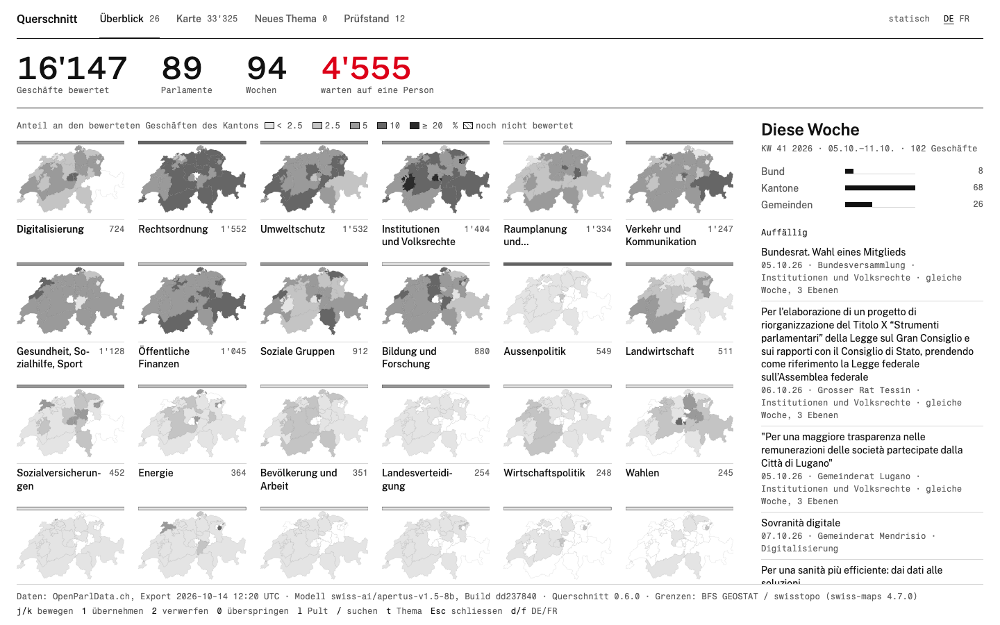
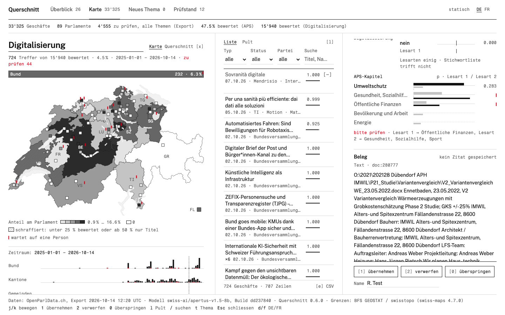

# Querschnitt

**One topic field for every Swiss parliament.** Querschnitt gives each OpenParlData affair — federal, cantonal and communal,
German, French and Italian — an Année Politique Suisse (APS) chapter with ranked subtopics, a lane that says when a person
should check, and — where the affair has a text and the evidence step has run — a quoted sentence that supports it. A new topic or a parliament's own scheme is a file:
written once, applied to every parliament, no training. Every topic decision is made by
[Apertus](https://www.swiss-ai.org/apertus), Switzerland's open model.

Built for Hack Apertus Liebefeld (18–19 Oct 2026), challenge «Topic classification for OpenParlData».
Live (static, read-only): https://querschnitt.mi11ion.io



## Measured
Human labels first. Each test was written down and hashed before its result ([eval/PREREG-BUILD.md](eval/PREREG-BUILD.md));
choices made after a result — the 0.7 lane threshold, the hierarchical metrics — are labelled so, and the lane was then
tested on the held-out set. S25's amendment records the two readings seen before a determinism fix, next to the final one. Full tables with intervals, baselines, per-language and
per-level breakdowns and source files: [docs/PRUEFSTAND.md](docs/PRUEFSTAND.md) · short report: [docs/REPORT.md](docs/REPORT.md).

**Against human labels** — APS editors, the parliaments' own fields:

| Test | n | Querschnitt | Baseline on the same items |
|---|---|---|---|
| APS chapter vs APS editors, 927 federal affairs never used while designing (held out, pre-registered) | 927 | **0.696** [0.666, 0.726]; top 3 0.839; the 67.3% that pass without a check (recalibrated p ≥ 0.7) 0.812 [0.779, 0.842], the rest 0.458; subtopic top 1 0.497, hierarchical F1 0.604 (computed after the result) | plain list prompting 0.654 [0.623, 0.685] (n 918; paired +0.041 [+0.016, +0.067]) · keywords 0.186 |
| The same question on the 1,357 federal affairs the shipped design was chosen on (pre-registered) | 1,357 | 0.740 [0.716, 0.764]; the 66.8% that pass without a check (cross-fitted) 0.864 [0.840, 0.886] | plain list prompting 0.655 · keywords 0.191 |
| Five design variants tried on those 1,357 (leave-one-out examples; not a test): none clears the pre-set gate of +0.02 | 1,357 | best +0.0117 [−0.0008, +0.0244]; the held-out affairs were not touched | shipped design |
| The same 1,357 as shipped: `make eval GOLD=data/eval/gold_aps_s9.csv` on the production rows (OPD inputs, the corpus pipeline) | 1,340 | 0.718 [0.693, 0.743]; top 3 0.860 | — |
| The same affairs from the Italian vs the German text (read-back design, no examples) | 1,350 | Italian 0.702 [0.678, 0.727] · German 0.703 [0.678, 0.728]; difference +0.0007 [−0.020, +0.021] | — |
| The held-out affairs on an endpoint without assistant prefill (the labelled fallback mode, pre-registered) | 927 | 0.705 [0.675, 0.734] vs 0.696 with prefill; paired −0.008 [−0.022, +0.004] | — |
| Bern's 8 directorates as a scheme file vs the Grand Council's own lead-directorate field, 2025–26, DE / FR titles | 531 | 0.651 [0.610, 0.691] / 0.650; DE–FR +0.001 [−0.031, +0.034] | keywords 0.525 / 0.512 · majority 0.214 |
| Basel-Stadt's own 46 themes as a scheme file (names only) vs the canton's hand-assigned «Thema 1», 2019–24 | 2,437 | 0.498 [0.478, 0.518]; Thema 1 or 2: 0.605; top 3: 0.665 | keywords 0.181 · majority 0.053 |
| — with five of Basel's own labelled affairs as examples (other half of the data; no training) | 2,437 | 0.526 [0.506, 0.547], +0.028 [+0.014, +0.043] paired; top 3: 0.711; where the two readings agree (54.9%): 0.651 | names only: 0.498 |
| Ticino's Gran Consiglio, in Italian: its own lead department (6 units) as a scheme file vs the department the canton assigns, 2023–26, affairs whose text does not name it (pre-registered) | 1,685 | 0.647 [0.624, 0.670]; where both readings agree (83% of affairs) 0.698 | keywords 0.219 · majority 0.194 |

**Against a blind AI judge** — where no human labels exist (figures are agreement with that judge), and the DVS list:

| Test | n | Querschnitt | Baseline on the same items |
|---|---|---|---|
| Evidence on production rows: the stored quote supports the topic (blind AI judge, κ 0.92) | 200 | 0.815 [0.755, 0.863]; exact substring at the stored offsets 198/198 | — |
| Three new topics, each defined in one sentence (wolves · heat protection · AI in schools), Aug–Oct 2026, blind AI judge | 774 | precision of flags 0.225 · 0.670 · 0.136; with a verification question on the flags 0.444 · 0.770 · 0.250 (keeping 0.444 · 0.969 · 1.000 of the relevant ones) — unverified flags go to «please check»; recall outside the checked affairs is not measured (no judge positive among 120 random unflagged affairs per topic) | keywords 0.500 · 0.900 · 0.750 |
| Three more narrow topics (light pollution · drones · pesticides), held out, with a generated scope check on the flags (pre-registered) | 399 judged | precision of flags 0.642 → 0.761, +0.119 [+0.005, +0.260]; recall −0.099 [−0.250, 0.000] (the dropped ones go to «please check») | keywords: precision 0.944 |
| "Digitalisierung" in every Swiss parliament, 2026: all 14,512 affairs decided (651 flagged); a stratified sample judged blind by an AI judge and weighted back (pre-registered) | 453 judged (180 flags) | precision of flags 0.905 [0.865, 0.945]; recall estimated at 0.659 [0.491, 0.900] | keywords: precision 0.756 |
| "Digitalisierung": the 30 affairs DVS curated by hand (the question and its 0.5 cut-off were written with these items in view) | 30 | 27 recognised | keywords 21 |

## Quick start
```sh
make install                # .venv with Python 3.12 (uv, else python3.11+ venv); the first target that needs it runs it too
make data                   # the scored data (GitHub release `data-latest`): app export, inputs, topic rows (~30 s)
make run                    # API + app at http://127.0.0.1:8000 (SQLite; no model calls)
make test                   # ~1 min; a fake model endpoint, no network
make eval GOLD=data/eval/gold_aps_s9.csv   # APS editors' chapters on their production rows → 0.718 [0.693, 0.743], 963/1340
make eval GOLD=my.csv       # score any labelled CSV (affair_id,label) against the stored topic rows
make claims                 # every number in README and docs backed by eval/claims.tsv or eval/pruefstand.json
```
Model calls need an OpenAI-compatible chat endpoint serving Apertus (`QS_BASE_URL`, `QS_MODEL`, `QS_API_KEY`) that also
supports assistant prefill (vLLM's `continue_final_message`) and `top_logprobs`, the two capabilities every measured
number depends on; Public AI's `swiss-ai/apertus-v1.5-8b` route has both and is the default. `python tools/probe_endpoint.py`
checks an endpoint (prefill, log-probabilities, served build, throughput, replay of stored prompts) and prints the settings
to use; without prefill, `QS_PREFILL=0` runs a fallback mode with its own prompt ids, measured on the held-out affairs (0.705
vs 0.696 with prefill; no calibration map yet) ([docs/SERVICE.md](docs/SERVICE.md)).

## How it works
- **Closed choices only.** Chapter, subtopic, yes/no for an ad-hoc topic, evidence sentence: each is a choice among listed
  codes, read from Apertus's next-token probabilities, so a label outside the scheme is never stored. (Asked to name a topic
  freely, Apertus answered outside the scheme in 36 of 40 affairs; with the list shown, in 0 of 40.)
- **Two readings, one confidence, one lane.** The chapter question is read twice — for federal affairs once with the five most similar
  APS-labelled affairs as examples and once without, in two code orders; elsewhere in two code orders (the second only when
  the first is below p 0.9); in bilingual parliaments (Bern, Fribourg, Valais, from OPD's body languages) in German and in
  French. The two readings feed the confidence and stay visible as the explanation; the lane is `please_check` when the
  recalibrated p is below 0.7 or the German and French readings disagree, otherwise `pass` (on the 927 held-out federal
  affairs: 67.3% pass and are right in 0.812, the rest in 0.458; on the 1,357 design affairs, cross-fitted: 66.8% at 0.864).
  Cantonal and communal affairs are often title-only and less certain; in production about half of them go to a person.
- **Read back from the subtopic.** One request over the subtopics of the top two or three chapters; the shipped chapter is
  the one read back from the chosen subtopic; the top three subtopics ship as ranked suggestions.
- **Evidence.** One numbered sentence of the affair, chosen by Apertus, checked by code as an exact substring and stored
  with its character offsets.
- **Schemes are files** (`src/querschnitt/schemes/`): `aps.yaml` (24 chapters × 190 subtopics, APS identifiers),
  `be-directorates.yaml` (Bern), `bs-themen.yaml` (Basel-Stadt, theme names verbatim), `adhoc/*.yaml` (Digitalisierung and
  three topics defined in one sentence each). A new scheme or topic is a new file; nothing is trained.
- **Builds are never mixed.** Every row names the served model, its `system_fingerprint`, the prompt id and the input hash;
  a run locks the first build it sees and stops on any other. Tests pin the prompts byte-identical to the measured ones.



## Integration with OpenParlData
- **Output:** a `topics` row per affair, scheme and rank ([docs/CONTRACT.md](docs/CONTRACT.md); Postgres DDL in
  [sql/topics.sql](sql/topics.sql)): code, rank, `p` (recalibrated), lane, `status` (suggested | confirmed | rejected),
  `provenance` (inferred | confirmed), evidence `{source, char_start, char_end, quote}`, model, build, prompt id, input hash,
  `valid_from` / `valid_to`. Generated and confirmed content stay distinguishable; a correction adds a row, never overwrites.
- **API:** `GET /affairs/{id}/topics`, `GET /topics/{scheme}/{code}/affairs`, `POST …/confirm|reject|undo`,
  `GET /changes?after=<seq>` (a cursor feed for re-sync), `GET /coverage`, `/metrics`, Neues Thema (`POST /adhoc`, SSE).
- **Upstream pack** ([docs/UPSTREAM.md](docs/UPSTREAM.md)): migration files in OPD's naming, an Apache Hop pipeline that loads
  the bulk file (run with `hop-run`), the Prüfstand as an evaluation task for any Apertus build.
- **Operations:** `docker compose --profile lite` (nightly chapter and subtopic steps into an existing Postgres) or `--profile full`
  (Postgres + API + app + nightly); footprint measured by CI on every push ([docs/SERVICE.md](docs/SERVICE.md)). The nightly
  delta reads OPD's published exports only, queues new and changed affairs and drains the queue when the endpoint is back.

## Runtime and cost (measured on the corpus run, Public AI list price — [`eval/cost/results.json`](eval/cost/results.json))
- USD 0.333 per 1,000 affairs for chapter, subtopic and one ad-hoc topic (USD 0.314 for the chapter and subtopic steps alone).
- About 61.5 minutes per 1,000 affairs at this job's average 0.969 requests/s over its first 13.3 h on a key shared with
  other jobs (lower while several jobs share the key).
- All 326,123 OPD affairs, chapter and subtopic steps: 843,173 requests, USD 102.24, about 241.8 h at that average rate — a projection, not run;
  a dedicated endpoint shortens it in proportion to its rate.

## Model roles
Apertus makes every topic decision, through Public AI's route `swiss-ai/apertus-v1.5-8b` (served build `…dd237840` on
every call reported here; measured behaviour of this route: [upstream/APERTUS-NOTES.md](upstream/APERTUS-NOTES.md)). Retrieval of examples is BM25 in code. In the evaluation only,
blind Claude runs and the open-weights Qwen-SEA-LION serve as annotators where no human labels exist; every figure measured
against them is labelled as agreement with that judge. The code was written with Claude Code. The route name does not fix the model's size: on the same 250 MMLU questions the model behind it scored 211/250
against 177/250 for `apertus-8b-instruct` (v1 8B); read every figure as "the model behind that route and build".

## Licences
Code Apache-2.0 ([LICENSE](LICENSE)); documentation CC BY 4.0; the topics file CDLA-Permissive-2.0. Source data:
OpenParlData bulk exports (files.openparldata.ch); Basel-Stadt topics OGD 100086 (CC BY 4.0, Kantons- und
Stadtentwicklung Basel-Stadt); boundaries BFS GEOSTAT / swisstopo via swiss-maps 4.7.0. APS chapter codes and subtopic
identifiers as published by Année Politique Suisse.
